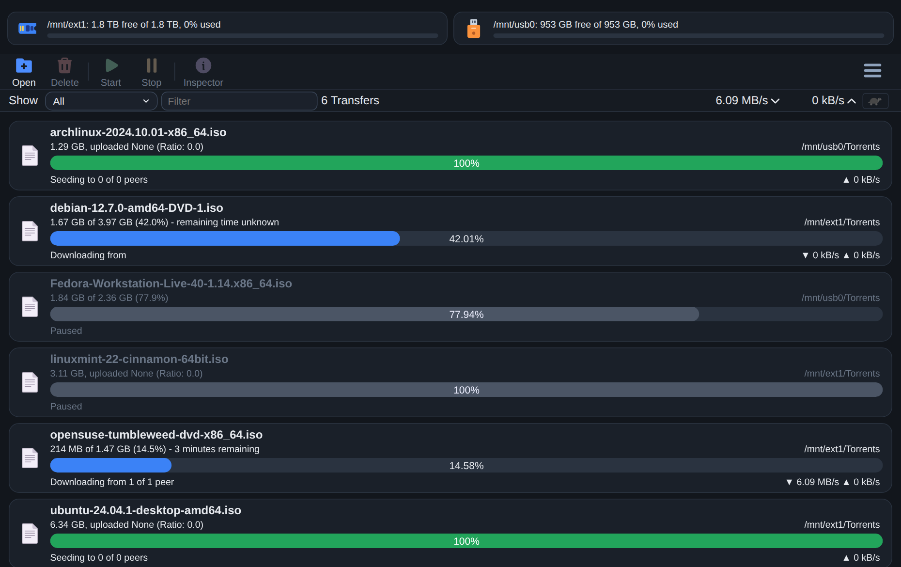
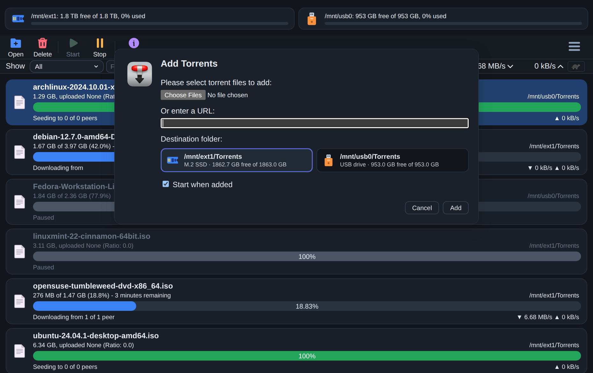
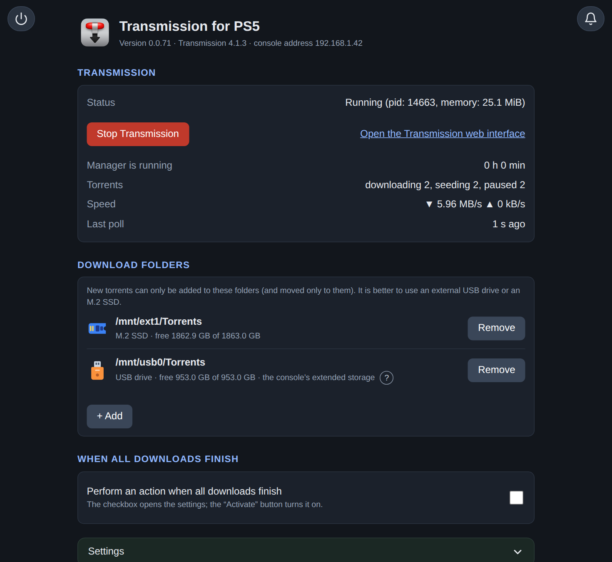
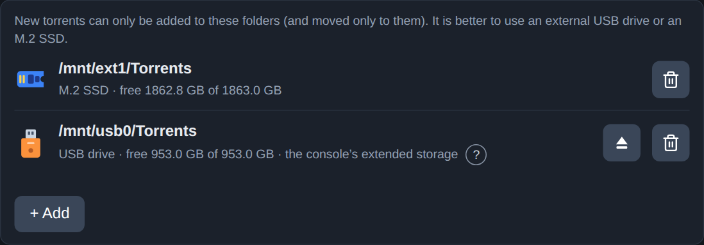
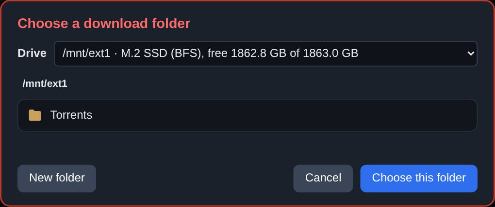
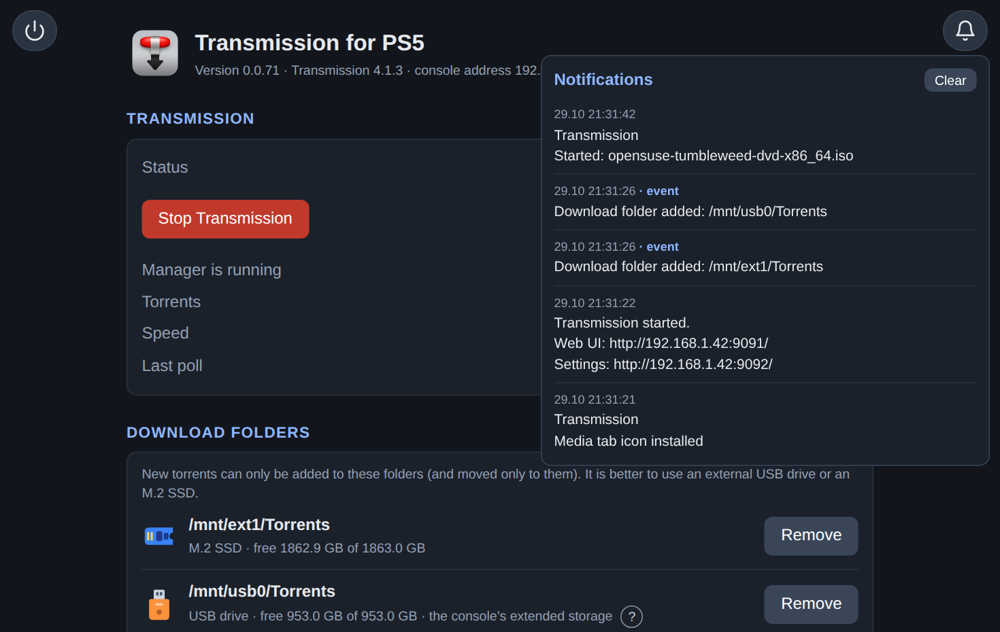

<div align="center">

<h1>&nbsp; Transmission for PS5</h1>

**English** · [Русский](README.ru.md)

**An unofficial, open-source torrent client for the PS5 homebrew scene.**
[Transmission](https://transmissionbt.com) 4.1.3 as one payload file. Download torrents straight to your console.

[](https://github.com/freefelt/transmission_ps5/releases/latest)
[](https://github.com/freefelt/transmission_ps5/actions/workflows/build.yml)
[](LICENSE)
[](#-good-to-know)
[](https://transmissionbt.com)
[](#-languages)
[](https://github.com/freefelt/transmission_ps5/releases)
[](https://github.com/freefelt/transmission_ps5/stargazers)
[](#-contributing)

</div>

> [!IMPORTANT]
> This is the first public release (`0.1`), so expect rough edges. It is developed and tested on firmware **11.20**. On **10.01** a user reported that it starts and downloads
> a torrent (not fully tested); other firmware versions are not verified yet. Your console must **already** be able to run payloads (an ELF loader that listens on port 9021). This
> project does not jailbreak anything and does not help with it.

> [!NOTE]
> **Unofficial.** This project is not made, endorsed or supported by the Transmission project or by Sony. "Transmission" is the name of the
> original program, "PlayStation" and "PS5" belong to Sony. They are used here only to say what this is for.

## ✨ What you get

- **The Transmission web page** on port 9091, made to look good in the PS5 browser: dark and light themes, a panel with free space on your disks, tiles for choosing a folder.
- **A settings page** on port 9092: the state of Transmission, a bell with notifications, and every setting in one place.
- **Download folders you choose.** Torrents can only go to the folders you put on a list. A folder on a disk that is not plugged in is never used, so Transmission cannot fill the console's own memory by accident.
- **Care for USB disks.** Disks formatted as exFAT or FAT32 can make a console hang on big torrents. A per-torrent "USB disk fix" prevents that, and the folder picker warns you. A USB disk can be unmounted from the page.
- **A watchdog.** It starts, stops and restarts Transmission when it hangs or when the network changes, and remembers which torrents were running.
- **Sleep and power.** When all downloads are finished, the console goes to rest mode or turns off. Downloads pause while a game is on the screen.
- **Notifications** on the console and in a log.
- **English and Russian** are built in; any other language is a plain text file ([how](#-languages)).
- An optional **icon** on the "Media" tab that opens the settings page.

## 📸 Screenshots

*Screenshots from a desktop browser.*

|  |  |
|:--:|:--:|
|  |  |
| The Transmission page | Adding a torrent |
|  |  |
| The settings page | Download folders |
|  |  |
| Choosing a folder | Notifications |

## 📥 Install

**What you need:** a PS5 that can already run payloads, and a phone or a computer in the **same home network** as the console.

### Step 1. Download the file

👉 **[Open the latest release](https://github.com/freefelt/transmission_ps5/releases/latest)**

On that page scroll down to **Assets** and click the file **`Transmission-<version>.elf`**: it downloads to your computer.
The version is always in the name of the file, so you can see which one you have. Older versions are on the [page with all releases](https://github.com/freefelt/transmission_ps5/releases).

### Step 2. Find the address of your PS5

On the PS5 open **Settings → Network → Connection Status → View Connection Status**. Write down the **IP address**, for example `192.168.1.42`.

### Step 3. Send the file to the console

Send the file to the **ELF loader** of your console, port **9021**. Use the payload sender you already use, or this command on macOS and
Linux (put your IP address in it):

```sh
nc -q0 192.168.1.42 9021 < Transmission-<version>.elf
```

### Step 4. Wait for the message

After a few seconds the console shows a notification with an address like `http://192.168.1.42:9092`. That is your **settings page**.

### Step 5. Open the settings page

On your phone or computer open that address in a browser. You should see the page "Transmission for PS5". 🎉

### Step 6. Choose a folder for your downloads (you must do this once)

1. On the settings page find the card **Download folders** and press **+ Add**.
2. Choose a disk and a folder. The M.2 SSD is the best place (it is shown as `/mnt/ext1`). USB disks are `/mnt/usb0`, `/mnt/usb1`...
3. Press **Choose this folder**.

Without a folder Transmission **refuses** to add torrents. This is on purpose: it protects your console.

### Step 7. Add a torrent

1. Open **`http://<your PS5 IP>:9091`** (for example `http://192.168.1.42:9091`). This is the Transmission page.
2. Press **Open torrent**, paste a link (or choose a file), pick your folder from the tiles and press **Add**.
3. Watch it download. 🚀

> [!TIP]
> You can do steps 5 to 7 from the PS5's own browser, too. And after a reboot of the console just send the `Transmission-<version>.elf` file again (Step 3).

### Update, stop, remove

- **Update:** send the new file again (Step 3). Only the manager is replaced, a running Transmission is not interrupted.
- **Stop completely:** on the settings page press the exit button in the top-left corner. Your torrents are paused and remembered.
- **Remove:** restart the console and do not send the file again. If you installed the icon, press **Remove** in the icon section first. All data is in `/data/Transmission/`; delete that folder if you want to remove everything.

## 💡 Good to know

- **Best disk:** the M.2 SSD, or a USB disk that you formatted **with the console** as "extended storage".
- **exFAT and FAT32 disks** work, but only with the **USB disk fix** (it is on by default for them). Without it a big torrent can freeze the whole console. The picker shows a red "not recommended" next to such disks.
- **Do not pull a USB disk out** while torrents are running. Use the eject button (**Unmount the drive**) next to the folder on the settings page (for the console's extended storage it may refuse: then use "Safely remove from PS5" in the console settings).
- **No password.** The settings page and the web interface are open to everyone in your home network, which is fine at home. Do not forward their ports to the internet.
- **Tested on firmware 11.20.** On 10.01 it starts and downloads a torrent (a user's report). If you try another one, please tell us how it went (open an issue).

## 🛟 Something does not work?

| Problem | What to do |
|---|---|
| The page does not open | Check that your phone or computer is in the same network as the PS5, and use the exact address from the notification. If port 9092 is busy, the next free port is used, and the notification shows it. |
| "Folder is not in the list" or a torrent is not added | Add a download folder first (Step 6). |
| A folder says "disk not connected" | Plug the disk in again. Torrents on a missing disk are never started. |
| Nothing happens after sleep | A known problem of some loaders: send the file again. |
| The console freezes with a USB disk | Make sure the **USB disk fix** was on for that torrent, or use the M.2 SSD. |

Still stuck? Open an [issue](https://github.com/freefelt/transmission_ps5/issues) and attach **Diagnostics → Daemon log** from the settings page.

## 🌍 Languages

The settings page is written in English, and Russian is built in. To add **your** language: copy `locales/en.strings` to
`/data/Transmission/locales/<name>.strings` on the console, translate the values (keep the keys on the left), then choose the language
on the settings page. The format of the file is described at the top of `locales/en.strings`.

## 🛠 Build it yourself

```sh
./build.sh
```

That is all: the script downloads what it needs into `.deps/` (the PS5 SDK, zlib, libevent, OpenSSL, curl, Transmission), builds
everything, checks the imports of the result and writes **`build/Transmission-<version>.elf`** (about 12 MB). Every download is
pinned to an exact version and verified with a SHA-256; nothing newer is ever picked up silently. The first build takes from several
minutes to half an hour depending on the machine, later ones are much faster.

| System | Needs |
|---|---|
| **macOS** (not verified) | [Homebrew](https://brew.sh) (the script installs `llvm@18`, `cmake` and `perl` with it; `./build.sh --no-brew` skips that), `curl`, `tar`, `make`, `patch` (all part of the system) |
| **Linux** (Ubuntu 24.04 is what it is checked on) | `clang-18 lld-18 llvm-18-dev cmake make patch perl curl xz-utils unzip` and `build-essential` |
| **Windows** | use [WSL2](https://learn.microsoft.com/windows/wsl/install) with Ubuntu and follow the Linux line; building natively is not supported |

Verified on Ubuntu 24.04 (x86_64). On macOS it should work too (the scripts are written for it), but it has not been verified and is not checked automatically.
The tools that are not pinned are only the ones on your machine (clang 18, cmake): their minor versions can differ from the ones used by the author.

Everything the payload stores is in `/data/Transmission/` (`config.cfg`, `logs/`, the state of Transmission).

## 🧪 Tests

The tests start the real daemon and manager and emulate disks with `tmpfs`, so they need **Linux with root** and write to `/data`,
`/mnt` and `/user`: use a virtual machine made for this, not your everyday computer.

```sh
sudo tests/setup-env.sh --install-chrome      # once: folders, a network address for the swarm tests, Node modules, Chromium
tests/check-env.sh                            # checks the machine
./build.sh                                    # the tests use the web files and icons it generates
tests/build/build-test-binaries.sh            # the daemon and the manager built for this machine (repeat after changes in src/)
sudo scripts/test.sh smoke                    # a quick check; `full` runs all Python suites (about half an hour)
sudo scripts/test.sh pages                    # the page tests (jsdom and Chrome); `scripts/test.sh list` shows the areas
```

## 🗂 Repository layout

| Folder | What it is |
|---|---|
| `src/` | our own sources of the payload: `manager/` (the manager, C and C++), `daemon/` (the daemon wrapper, C), `common/` (code shared by both), `icon-helper/`, `asm/` |
| `patches/` | everything that changes or extends Transmission: `transmission/` (our behaviour changes), `ps5/` (only to make it build and run on the PS5), `web-client/` (changes to the Transmission web interface: a script that patches its files plus the JS and CSS files it adds) |
| `locales/` | translation tables (`en.strings`, `ru.strings`) |
| `resources/` | icons |
| `scripts/` | the build steps called by `build.sh`, the import check, `test.sh` |
| `tools/` | developer tools for the translation tables (Node) |
| `tests/` | the tests |
| `docs/` | documentation |
| `VERSION` | the version of the payload (it becomes the name of the file and is shown on the settings page) |

How the pieces fit together: `build.sh` runs `scripts/deps.sh` (SDK and libraries), then `scripts/build-elf.sh` (unpacks Transmission,
applies `patches/`, builds the daemon and the manager, embeds the daemon and the icon helper in the manager) and
`scripts/check-imports.sh` (the PS5 loader crashes on an import it does not know, so the result is compared with
`scripts/allowed-imports.txt`).

## 🤝 Contributing

Issues and pull requests are welcome. Please keep a change small and focused, and say on which firmware (and with which disks) you tried it:
the tests run on a Linux host, not on a console, and a change that was not tried on a console should say so.

- **Read [`CLAUDE.md`](CLAUDE.md).** It is the long-term memory of the project: the architecture, the rules (for example, the PS5 loader
  crashes on an unknown import, so `./build.sh` runs an import check), the findings from real consoles, the traps, what was tried and
  postponed (for example, the context menu on the Square button), and the open questions. It is written for coding agents as much as for
  people. Also read [`docs/payload-safety-notes.md`](docs/payload-safety-notes.md) before you touch files, the network, processes or devices:
  a payload has no sandbox, and the main aim of this project is to minimize the risk of harm to the console.
- Changes to Transmission itself are patches (see [`patches/README.md`](patches/README.md)); the logic goes into `src/`.
- New text on the settings page goes into `locales/en.strings` and `locales/ru.strings` (see [Languages](#-languages)); a new language is a plain text file.
- Comments, commit messages and documentation are in English.
- Run the checks that match your change (see [Tests](#-tests)); please do not run the tests on your everyday machine.

**Working with a coding agent.** If you use an AI agent (Claude Code or another one that reads `CLAUDE.md`), start it in the root of the
repository with a prompt like this:

> Read `CLAUDE.md` and `docs/payload-safety-notes.md` completely, then `README.md` and `patches/README.md`. Do not change anything yet.
> Tell me in a few sentences how the project is built and tested and what the rules of this repository are. After that I will describe the
> change I want. Discuss the plan with me before editing, keep the change small, build with `./build.sh` (it must report no extra
> imports), and tell me exactly what you verified and what you could not (you cannot try anything on a console). Do not add new
> dependencies, file or network access, or system calls without asking.

## 📜 License and credits

The project is licensed under the **GPL-3.0-or-later**, like Transmission, which it builds on. Transmission, the PS5 payload SDK
([ps5-payload-dev/sdk](https://github.com/ps5-payload-dev/sdk)), the icon sets (Lucide, MingCute, Fluent) and the other
components keep their own licenses; they are listed in [`THIRD_PARTY_NOTICES.md`](THIRD_PARTY_NOTICES.md), on the settings page
("Credits and licenses") and in `patches/web-client/icons/README.md`. The original Transmission icon is by Zabriskije.
