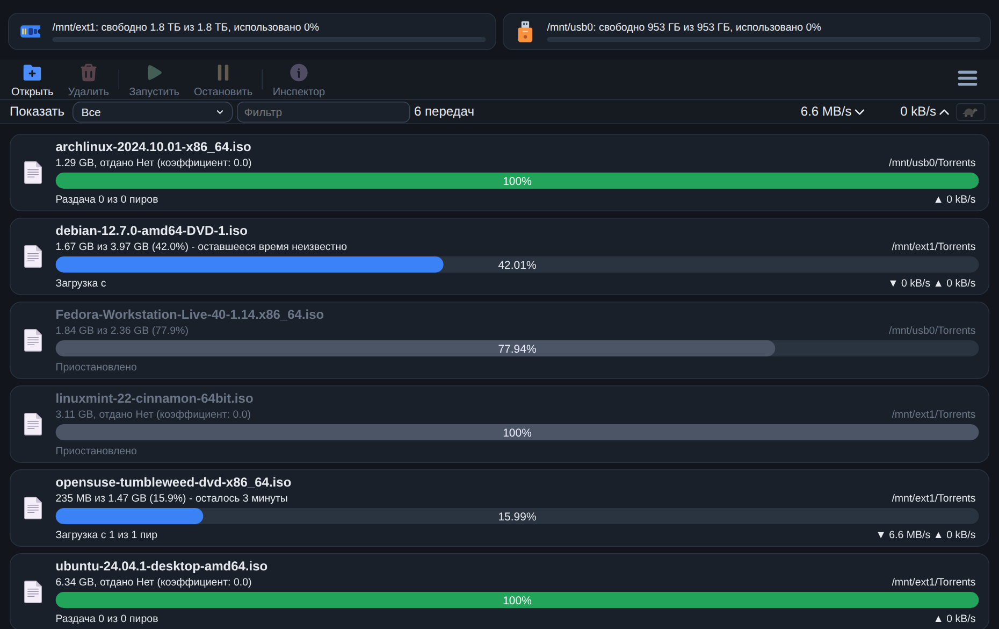
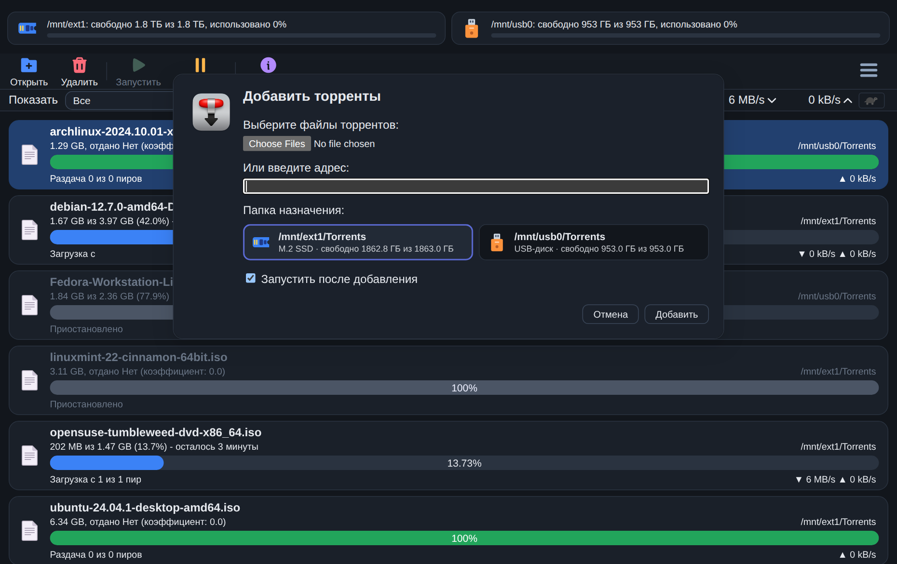
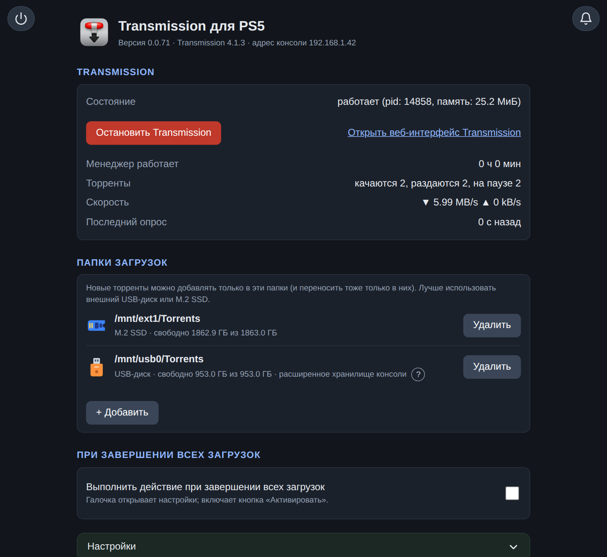
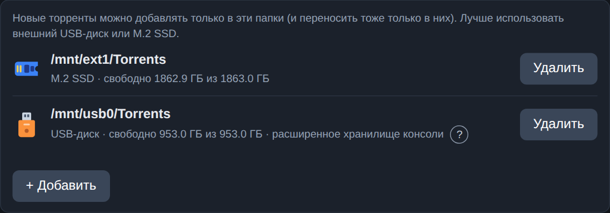
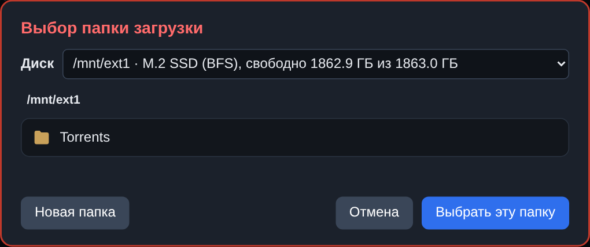
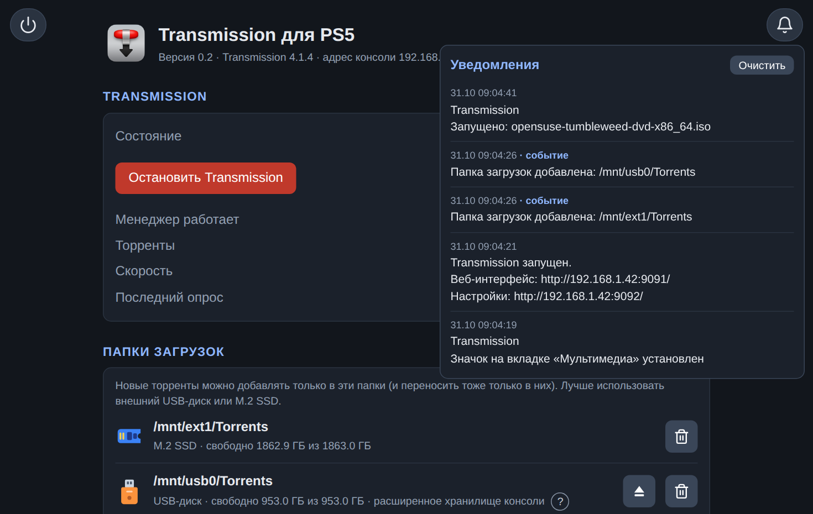

<div align="center">

<h1>&nbsp; Transmission для PS5</h1>

[English](README.md) · **Русский**

**Неофициальный торрент-клиент с открытым кодом для хоумбрю-сцены PS5.**
[Transmission](https://transmissionbt.com) 4.1.3 в одном файле-пейлоаде. Качайте торренты прямо на консоль.

[](https://github.com/freefelt/transmission_ps5/releases/latest)
[](https://github.com/freefelt/transmission_ps5/actions/workflows/build.yml)
[](LICENSE)
[](#-полезно-знать)
[](https://transmissionbt.com)
[](#-языки)
[](https://github.com/freefelt/transmission_ps5/releases)
[](https://github.com/freefelt/transmission_ps5/stargazers)
[](#-как-помочь-проекту)

</div>

> [!IMPORTANT]
> Это первый публичный релиз (`0.1`), так что возможны шероховатости. Он делается и проверяется на прошивке **11.20**. На **10.01** пользователь сообщил, что пейлоад запускается и
> качает торрент (проверено не полностью); на других прошивках пока не проверялся. Ваша консоль **уже должна** уметь запускать пейлоады (ELF-загрузчик, слушающий порт 9021). Этот проект ничего не
> взламывает и в этом не помогает.

> [!NOTE]
> **Неофициальный проект.** Он не создан, не одобрен и не поддерживается ни проектом Transmission, ни Sony. «Transmission» это название
> оригинальной программы, «PlayStation» и «PS5» принадлежат Sony. Здесь они используются только затем, чтобы сказать, для чего это.

## ✨ Что вы получаете

- **Страница Transmission** на порту 9091, подогнанная под браузер PS5: тёмная и светлая темы, панель со свободным местом на дисках, плитки для выбора папки.
- **Страница настроек** на порту 9092: состояние Transmission, колокольчик с уведомлениями и все настройки в одном месте.
- **Папки загрузок, которые выбираете вы.** Торренты можно добавлять только в папки из вашего списка. Папка на отключённом диске никогда не используется, поэтому Transmission не заполнит память самой консоли по ошибке.
- **Забота о USB-дисках.** Диски exFAT и FAT32 могут повесить консоль на больших торрентах. «Фикс для USB дисков» для каждого торрента этого не допускает, а выбор папки предупреждает. USB-диск можно отмонтировать прямо со страницы.
- **Сторож.** Он запускает, останавливает и перезапускает Transmission, если тот завис или сменилась сеть, и помнит, какие торренты шли.
- **Сон и питание.** Когда все загрузки закончились, консоль уходит в режим покоя или выключается. Пока на экране игра, закачки ставятся на паузу.
- **Уведомления** на консоли и в журнале.
- **Русский и английский** встроены, любой другой язык это обычный текстовый файл ([как](#-языки)).
- Необязательная **иконка** на вкладке «Мультимедиа», которая открывает страницу настроек.

## 📸 Скриншоты

*Скриншоты из браузера на компьютере.*

|  |  |
|:--:|:--:|
|  |  |
| Страница Transmission | Добавление торрента |
|  |  |
| Страница настроек | Папки загрузок |
|  |  |
| Выбор папки | Уведомления |

## 📥 Установка

**Что нужно:** PS5, которая уже умеет запускать пейлоады, и телефон или компьютер в **той же домашней сети**, что и консоль.

### Шаг 1. Скачайте файл

👉 **[Открыть последний релиз](https://github.com/freefelt/transmission_ps5/releases/latest)**

На открывшейся странице прокрутите вниз до блока **Assets** и нажмите на файл **`Transmission-<версия>.elf`**: он скачается на ваш компьютер.
Версия всегда есть в имени файла, так что сразу видно, какая она. Старые версии лежат на [странице всех релизов](https://github.com/freefelt/transmission_ps5/releases).

### Шаг 2. Узнайте адрес вашей PS5

На PS5 откройте **Настройки → Сеть → Статус соединения → Узнать состояние соединения**. Запишите **IP-адрес**, например `192.168.1.42`.

### Шаг 3. Отправьте файл на консоль

Отправьте файл в **ELF-загрузчик** консоли, порт **9021**. Используйте программу для отправки пейлоадов, к которой вы привыкли, или эту
команду на macOS и Linux (подставьте свой IP-адрес):

```sh
nc -q0 192.168.1.42 9021 < Transmission-<версия>.elf
```

### Шаг 4. Дождитесь сообщения

Через несколько секунд консоль покажет уведомление с адресом вроде `http://192.168.1.42:9092`. Это ваша **страница настроек**.

### Шаг 5. Откройте страницу настроек

На телефоне или компьютере откройте этот адрес в браузере. Вы должны увидеть страницу «Transmission для PS5». 🎉

### Шаг 6. Выберите папку для загрузок (это нужно сделать один раз)

1. На странице настроек найдите карточку **Папки загрузок** и нажмите **+ Добавить**.
2. Выберите диск и папку. Лучшее место это M.2 SSD (он показывается как `/mnt/ext1`). USB-диски это `/mnt/usb0`, `/mnt/usb1`...
3. Нажмите **Выбрать эту папку**.

Без папки Transmission **откажется** добавлять торренты. Так сделано специально: это защищает вашу консоль.

### Шаг 7. Добавьте торрент

1. Откройте **`http://<IP вашей PS5>:9091`** (например `http://192.168.1.42:9091`). Это страница Transmission.
2. Нажмите **Открыть торрент**, вставьте ссылку (или выберите файл), выберите свою папку среди плиток и нажмите **Добавить**.
3. Смотрите, как идёт загрузка. 🚀

> [!TIP]
> Шаги 5–7 можно выполнить и в самом браузере PS5. А после перезагрузки консоли просто отправьте файл `Transmission-<версия>.elf` ещё раз (шаг 3).

### Обновить, остановить, удалить

- **Обновить:** отправьте новый файл ещё раз (шаг 3). Заменяется только менеджер, работающий Transmission не прерывается.
- **Остановить совсем:** на странице настроек нажмите кнопку выхода в левом верхнем углу. Торренты будут поставлены на паузу и запомнены.
- **Удалить:** перезагрузите консоль и больше не отправляйте файл. Если вы ставили иконку, сначала нажмите **Удалить** в разделе иконки. Все данные лежат в `/data/Transmission/`; удалите эту папку, если хотите убрать всё.

## 💡 Полезно знать

- **Лучший диск:** M.2 SSD или USB-диск, который вы отформатировали **самой консолью** как «расширенное хранилище».
- **Диски exFAT и FAT32** работают, но только с **фиксом для USB дисков** (для них он включён по умолчанию). Без него большой торрент может заморозить всю консоль. Рядом с такими дисками выбор папки показывает красное «не рекомендуется».
- **Не вынимайте USB-диск**, пока идут торренты. Используйте кнопку извлечения (**Размонтировать диск**) рядом с папкой на странице настроек (для расширенного хранилища она может не сработать: тогда используйте «Безопасно удалить из PS5» в настройках консоли).
- **Пароля нет.** Страница настроек и веб-интерфейс открыты всем в вашей домашней сети, дома это нормально. Не пробрасывайте их порты в интернет.
- **Проверено на прошивке 11.20.** На 10.01 пейлоад запускается и качает торрент (по сообщению пользователя). Если вы пробуете другую, расскажите, как получилось (создайте issue).

## 🛟 Что-то не работает?

| Проблема | Что делать |
|---|---|
| Страница не открывается | Проверьте, что телефон или компьютер в той же сети, что и PS5, и используйте точный адрес из уведомления. Если порт 9092 занят, берётся следующий свободный, и уведомление покажет его. |
| «Папки нет в списке» или торрент не добавляется | Сначала добавьте папку загрузок (шаг 6). |
| У папки написано «диск не подключён» | Подключите диск снова. Торренты на отсутствующем диске никогда не запускаются. |
| После сна ничего не происходит | Известная проблема некоторых загрузчиков: отправьте файл ещё раз. |
| Консоль зависает с USB-диском | Убедитесь, что для этого торрента был включён **фикс для USB дисков**, или используйте M.2 SSD. |

Всё ещё не получается? Создайте [issue](https://github.com/freefelt/transmission_ps5/issues) и приложите **Диагностика → Журнал демона** со страницы настроек.

## 🌍 Языки

Страница настроек написана на английском, русский встроен. Чтобы добавить **свой** язык: скопируйте `locales/en.strings` в
`/data/Transmission/locales/<имя>.strings` на консоли, переведите значения (ключи слева не меняйте) и выберите язык на странице
настроек. Формат файла описан в начале `locales/en.strings`.

## 🛠 Сборка своими руками

```sh
./build.sh
```

Это всё: скрипт сам скачает нужное в `.deps/` (PS5 SDK, zlib, libevent, OpenSSL, curl, Transmission), соберёт всё,
проверит импорты результата и запишет **`build/Transmission-<версия>.elf`** (около 12 МБ). Каждая загрузка привязана к точной
версии и проверяется по SHA-256; ничего новее втихую не подтянется. Первая сборка занимает от нескольких минут до получаса, в
зависимости от машины, следующие намного быстрее.

| Система | Что нужно |
|---|---|
| **macOS** (не проверялось) | [Homebrew](https://brew.sh) (скрипт ставит через него `llvm@18`, `cmake` и `perl`; `./build.sh --no-brew` это пропускает), `curl`, `tar`, `make`, `patch` (всё есть в системе) |
| **Linux** (проверено на Ubuntu 24.04) | `clang-18 lld-18 llvm-18-dev cmake make patch perl curl xz-utils unzip` и `build-essential` |
| **Windows** | используйте [WSL2](https://learn.microsoft.com/windows/wsl/install) с Ubuntu и следуйте строке про Linux; сборка прямо в Windows не поддерживается |

Проверено на Ubuntu 24.04 (x86_64). На macOS по идее тоже должно работать (скрипты под неё написаны), но это не проверялось и автоматически не проверяется.
Не закреплены по версии только инструменты на вашей машине (clang 18, cmake): их младшие версии могут отличаться от тех, что у автора.

Всё, что пейлоад хранит, лежит в `/data/Transmission/` (`config.cfg`, `logs/`, состояние Transmission).

## 🧪 Тесты

Тесты запускают настоящие демон и менеджер и эмулируют диски через `tmpfs`, поэтому им нужен **Linux с root**, и они пишут в `/data`,
`/mnt` и `/user`: используйте для этого виртуальную машину, а не рабочий компьютер.

```sh
sudo tests/setup-env.sh --install-chrome      # один раз: папки, сетевой адрес для тестов раздачи, модули Node, Chromium
tests/check-env.sh                            # проверяет машину
./build.sh                                    # тесты используют веб-файлы и значки, которые он создаёт
tests/build/build-test-binaries.sh            # демон и менеджер для этой машины (повторять после правок в src/)
sudo scripts/test.sh smoke                    # быстрая проверка; `full` запускает все Python-наборы (около получаса)
sudo scripts/test.sh pages                    # тесты страниц (jsdom и Chrome); `scripts/test.sh list` покажет области
```

## 🗂 Устройство репозитория

| Папка | Что это |
|---|---|
| `src/` | наш собственный код пейлоада: `manager/` (менеджер, C и C++), `daemon/` (обёртка демона, C), `common/` (общий код), `icon-helper/`, `asm/` |
| `patches/` | всё, что меняет или дополняет Transmission: `transmission/` (наши изменения поведения), `ps5/` (только чтобы он собирался и работал на PS5), `web-client/` (изменения веб-интерфейса Transmission: скрипт, который правит его файлы, и добавляемые JS и CSS) |
| `locales/` | таблицы переводов (`en.strings`, `ru.strings`) |
| `resources/` | значки |
| `scripts/` | шаги сборки, которые вызывает `build.sh`, проверка импортов, `test.sh` |
| `tools/` | инструменты разработчика для таблиц переводов (Node) |
| `tests/` | тесты |
| `docs/` | документация |
| `VERSION` | версия пейлоада (она становится именем файла и показывается на странице настроек) |

Как всё сходится: `build.sh` запускает `scripts/deps.sh` (SDK и библиотеки), затем `scripts/build-elf.sh` (распаковывает Transmission,
применяет `patches/`, собирает демон и менеджер, встраивает демон и помощника значка в менеджер) и
`scripts/check-imports.sh` (загрузчик PS5 падает на неизвестном импорте, поэтому результат сверяется со списком
`scripts/allowed-imports.txt`).

## 🤝 Как помочь проекту

Issues и pull request'ы приветствуются. Делайте изменения небольшими и целенаправленными и пишите, на какой прошивке (и с какими
дисками) вы пробовали: тесты идут на Linux-хосте, а не на консоли, и если изменение не пробовали на консоли, об этом нужно сказать.

- **Прочитайте [`CLAUDE.md`](CLAUDE.md)** (он на английском). Это долговременная память проекта: архитектура, правила (например,
  загрузчик PS5 падает на неизвестном импорте, поэтому `./build.sh` проверяет импорты), находки с настоящих консолей, ловушки, что уже
  пробовали и отложили (например, контекстное меню на кнопке Square) и открытые вопросы. Он написан в такой же мере для ИИ-агентов,
  как и для людей. Перед тем как трогать файлы, сеть, процессы или устройства, прочитайте и
  [`docs/payload-safety-notes.md`](docs/payload-safety-notes.md): у пейлоада нет песочницы, а главная цель проекта в том, чтобы
  свести риск навредить консоли к минимуму.
- Изменения самого Transmission оформляются патчами (см. [`patches/README.md`](patches/README.md)); логика пишется в `src/`.
- Новый текст страницы настроек добавляется в `locales/en.strings` и `locales/ru.strings` (см. [Языки](#-языки)); новый язык это обычный текстовый файл.
- Комментарии, сообщения коммитов и документация пишутся на английском.
- Запускайте проверки, соответствующие вашему изменению (см. [Тесты](#-тесты)); пожалуйста, не запускайте тесты на рабочем компьютере.

**Работа с ИИ-агентом.** Если вы пользуетесь ИИ-агентом (Claude Code или другим, который читает `CLAUDE.md`), запустите его в корне
репозитория с таким запросом:

> Read `CLAUDE.md` and `docs/payload-safety-notes.md` completely, then `README.md` and `patches/README.md`. Do not change anything yet.
> Tell me in a few sentences how the project is built and tested and what the rules of this repository are. After that I will describe the
> change I want. Discuss the plan with me before editing, keep the change small, build with `./build.sh` (it must report no extra
> imports), and tell me exactly what you verified and what you could not (you cannot try anything on a console). Do not add new
> dependencies, file or network access, or system calls without asking.

(Запрос оставлен на английском: так агент лучше следует правилам репозитория. Можно отвечать ему по-русски.)

## 📜 Лицензия и благодарности

Проект распространяется под лицензией **GPL-3.0-or-later**, как и Transmission, на котором он построен. Transmission, PS5 payload SDK
([ps5-payload-dev/sdk](https://github.com/ps5-payload-dev/sdk)), наборы значков (Lucide, MingCute, Fluent) и другие
компоненты сохраняют свои лицензии; они перечислены в [`THIRD_PARTY_NOTICES.md`](THIRD_PARTY_NOTICES.md), на странице настроек
(«Благодарности и лицензии») и в `patches/web-client/icons/README.md`. Оригинальный значок Transmission создан Zabriskije.
